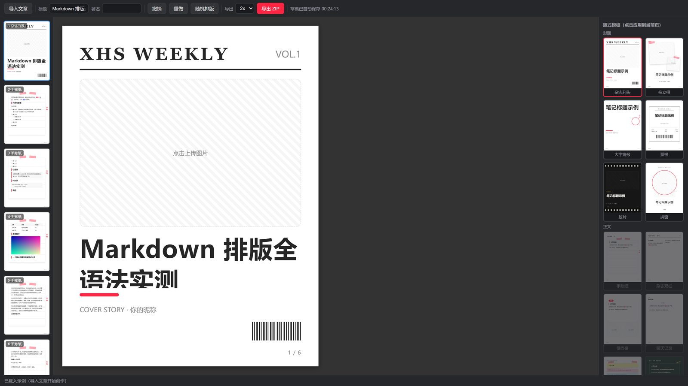
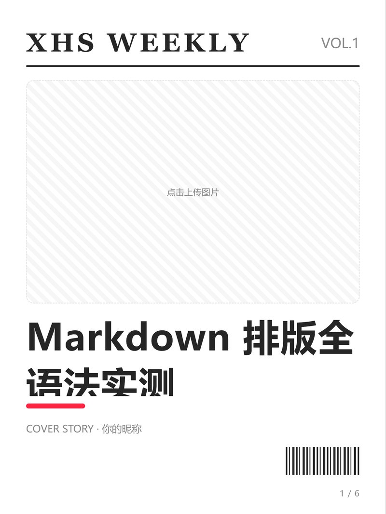
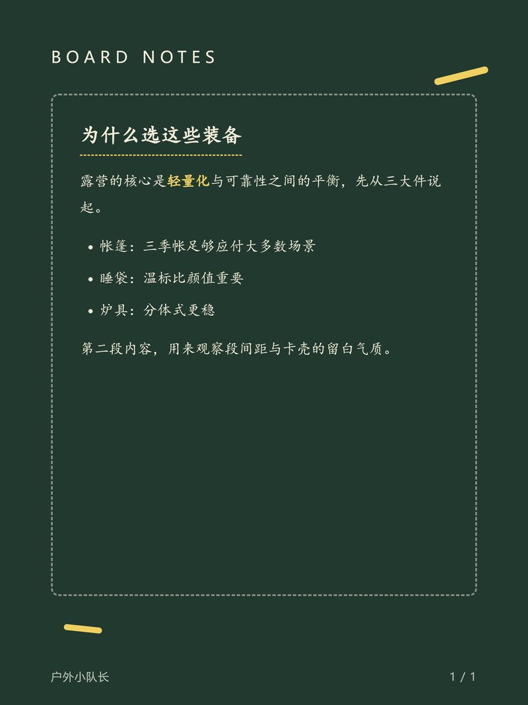
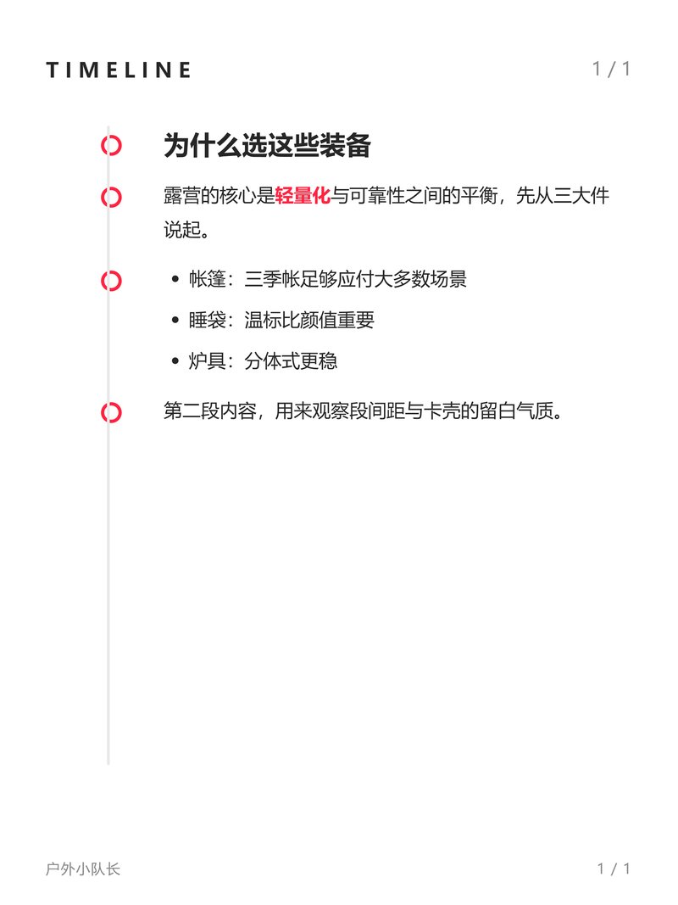

# 小红书图文助手

**Markdown 进，设计出。** 一个本地优先的小红书图文笔记工作台：导入 Markdown/txt → 套用 20 套设计模板 → 导出高清 PNG（ZIP）。

全部逻辑在浏览器内运行，**完全离线、无需注册、不写任何服务器**——数据不出你的电脑。

<p>
  
  
  
  
</p>



**41 秒产品宣传片**（苹果发布会风格，全片素材均为本产品真实渲染）：

[](docs/promo-720p.mp4)

> ▲ 4 倍速预览动图，[点击观看 41s 完整版（720p）](docs/promo-720p.mp4) ｜ [1080p 原版见 Release](https://github.com/facadefish/xhs-card-studio/releases/tag/v0.0.1)

## 快速开始

### 方式一：免安装便捷包（推荐，零门槛）

1. 在 [Releases](../../releases) 下载对应平台的便捷包：

   | 平台 | 文件 |
   |---|---|
   | Windows | `xhs-card-studio-v0.0.1-windows.zip` |
   | macOS（Apple Silicon） | `xhs-card-studio-v0.0.1-macos-arm64.zip` |
   | macOS（Intel） | `xhs-card-studio-v0.0.1-macos-intel.zip` |
   | Linux | `xhs-card-studio-v0.0.1-linux.zip` |

2. 解压到任意目录（U 盘也行）
3. **双击启动**（Windows 点 `小红书图文助手.exe`，macOS 点 `启动工作台.command`，Linux 跑 `./启动工作台.sh`）→ 浏览器自动打开工作台

> 无需安装 Python、Node 或任何依赖。关闭黑色控制台窗口即停止。
> 若杀毒软件误报（PyInstaller 单文件常见误报），加白名单即可；不放心可用方式二从源码启动。

### 方式二：源码运行（开发者）

只需要 **Python 3.11+**，无任何第三方依赖：

```bash
python web/serve.py        # 或双击 启动工作台.bat（需安装 uv）
```

浏览器打开 `http://127.0.0.1:8321` 即用。端口冲突时自动顺延（8321–8330）。

### 方式三：命令行转换（批量场景）

```bash
uv run md2xhs sample.md    # Markdown → PNG 卡片（Playwright 截图路线）
```

## 功能一览

- **20 套设计模板**：封面 6 / 正文 11 / 结尾 3，杂志刊头、拍立得、票根、胶片、手账纸、聊天记录、黑板报、终端、金句卡……每套按真实参考图复刻
- **8 套配色**一键换肤，自定义背景色时按亮度自动反推文字色
- **自动分页，从不裁字**：在真实 DOM 里逐页测量贪心填充，溢出自动补页
- **浏览器内导出**：整套卡片 3x 高清 PNG，打包 ZIP 一键下载
- **编辑器完整体验**：撤销/重做（40 步）、模板锁定、草稿自动保存（IndexedDB）、模板画廊真实缩略图预览
- **图片即拖即用**：正文插图、封面主图直接拖入

| | | |
|---|---|---|
|  |  |  |
|  |  |  |

## 上手三步

1. **导入**：点「导入」选择 `.md` / `.txt`，或直接粘贴文本
2. **设计**：左侧画廊选模板、换配色、调字号；封面/正文/结尾模板自由组合
3. **导出**：点「导出 ZIP」，得到可直接发布小红书的全套卡片

支持的 Markdown 语法：标题（`#`–`####`）、列表（含任务列表）、引用、代码块、表格、分隔线、粗体/斜体/行内代码、图片。`---` 可手动分页；不写则自动分页。示例见 [sample.md](sample.md)。

## 目录结构

```
web/            工作台本体（纯前端单页应用，无构建步骤）
  index.html    编辑器入口
  templates.js  20 套模板的声明式定义（加模板改这里）
  engine.js     渲染 / 分页 / 导出引擎
  app.js        UI 绑定
  serve.py      本地静态服务（仅托管，无任何渲染逻辑）
  gallery.html  20 套模板同内容画廊（验收用）
md2xhs/         旧 CLI 路线（Markdown → PNG，Playwright 截图）
launcher.py     免安装启动器（PyInstaller 打包入口）
scripts/        开发工具（参考图采集、截图对比、E2E 测试）
references/     模板参考图与来源记录
docs/           文档与 README 配图
```

## 开发

```bash
uv sync                                              # 装开发依赖（CLI 路线需要）
uv run md2xhs sample.md                              # CLI 转换
uv run python scripts/e2e_studio.py                  # E2E 测试（需先起 serve.py）
uv run python scripts/e2e_gallery.py                 # 20 套模板逐套截图
```

架构约定与修改硬约束见 [AGENTS.md](AGENTS.md)（改 `templates.js` / `engine.js` 前必读）。

## 常见问题

**Q: 数据会上传吗？**
不会。应用是纯静态网页 + 本地静态服务，无任何网络请求（唯一第三方库 markdown-it 已本地内置于 `web/vendor/`）。草稿存在浏览器 IndexedDB 里。

**Q: 便携版杀软误报？**
PyInstaller 单文件 exe 的常见误报。加白名单，或改用源码方式运行（`python web/serve.py`），两者功能完全一致。

**Q: macOS 提示「无法验证开发者」？**
便捷包未做 Apple 公证。右键程序 →「打开」即可；或终端执行 `xattr -dr com.apple.quarantine <解压目录>`。

**Q: 导出的卡片尺寸？**
1242×1656（小红书 3:4），3x 渲染输出 2484×3312 PNG。

## 路线图

- [ ] 更多模板与配色（欢迎投稿）
- [ ] 自定义字体上传
- [x] Mac / Linux 便捷包（CI 三平台自动打包）
- [ ] 长图拼接导出

## License

[MIT](LICENSE) — 自由使用、修改、分发，保留版权声明即可。
